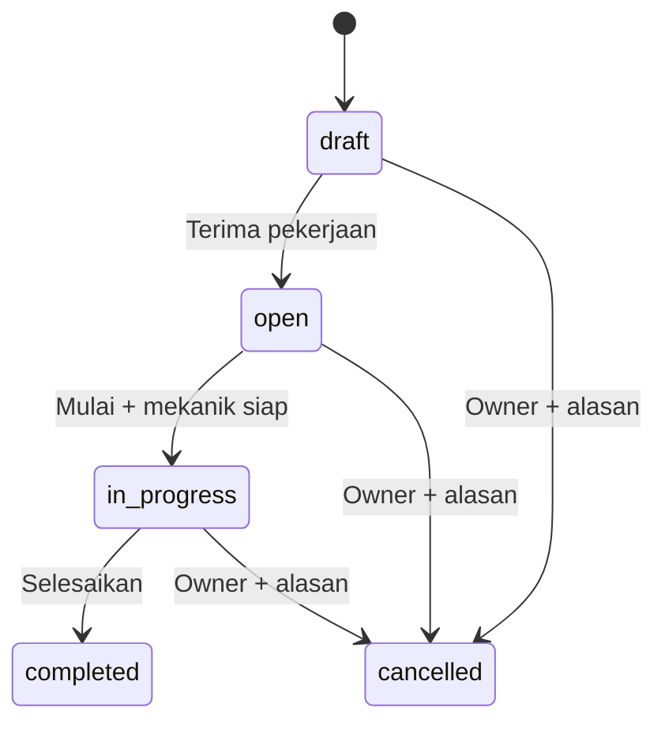

# Sprint 2 — Work Orders and Mechanics / Perintah Kerja dan Mekanik

> Scope approved / Scope disetujui: W01–W03 together plus mechanic account onboarding / W01–W03 sekaligus beserta akun mekanik.
> Date / Tanggal: 2026-11-10. Release tag / Tag rilis: `sprint-2-work-orders-v1`.

## Outcome / Hasil

**ID:** Cari kendaraan → buat WO → Antre → tugaskan mekanik → Dikerjakan → Selesai, atau batalkan dengan alasan. Tombol utama menerima pekerjaan langsung ke Antre; alternatifnya Simpan draft. Selesai pekerjaan belum berarti lunas. Paket berhenti sebelum Sprint 3.

**EN:** Find a vehicle → create a WO → queue → assign a mechanic → start → complete, or cancel with a reason. The primary creation action receives work directly into the queue; saving a draft is also available. Completion does not imply payment. This package stops before Sprint 3.

## Permissions / Akses

| Action / Aksi | Owner | Cashier / Kasir | Mechanic / Mekanik |
| --- | --- | --- | --- |
| View / Melihat | All active-workshop WOs / Semua WO bengkel aktif | Same / Sama | Own assignments / Tugas sendiri |
| Create, edit active details, assign / Buat, ubah detail aktif, penugasan | Yes / Ya | Yes / Ya | No / Tidak |
| Start, complete / Mulai, selesai | Yes / Ya | Yes / Ya | Own assignments / Tugas sendiri |
| Cancel with reason / Batal dengan alasan | Yes / Ya | No / Tidak | No / Tidak |
| Manage mechanic accounts / Kelola akun mekanik | Yes / Ya | No / Tidak | No / Tidak |

**ID:** Role dan membership aktif diperiksa ulang di server; tidak ada bypass `super_admin`. Session bengkel yang sudah dicabut/nonaktif ditolak. Form menyertakan konteks bengkel dan versi record; keduanya bukan bukti izin akses. Konflik versi menghasilkan HTTP 409 dengan arahan memuat ulang.

**EN:** The server rechecks roles and active membership; `super_admin` has no bypass. Revoked/inactive workshop sessions are rejected. Forms include workshop context and record versions, neither of which proves authorization. Version conflicts return HTTP 409 with reload guidance.

## Lifecycle / Alur status

**ID:** Satu kendaraan hanya memiliki satu WO aktif di bengkel yang sama, termasuk Draft. Kendaraan dan pelanggan hanya dapat diganti saat Draft. Keluhan/catatan dapat diperbaiki selama aktif, maksimal 5.000 karakter masing-masing. Mekanik opsional saat Draft/Antre, wajib aktif dan sudah membuat sandi sebelum mulai. Penugasan dapat diganti selama aktif; WO Dikerjakan tidak boleh tanpa mekanik. Selesai/Dibatalkan final, tanpa hapus atau buka kembali.

**EN:** Only one active WO per vehicle/workshop is allowed, including drafts. Vehicle/customer changes are restricted to drafts. Complaint/notes remain editable while active, up to 5,000 characters each. Mechanics are optional in draft/queue, but must be active and have completed password setup before starting. Assignments may change while active; work in progress cannot be unassigned. Completed/cancelled records are final, without deletion or reopening.

## Mechanic accounts / Akun mekanik

**ID:** Menu Mekanik khusus owner membuat user baru dengan email unik, sandi acak yang tidak ditampilkan, flag `needs_password_setup`, dan membership role `mechanic`. Tidak menautkan user yang sudah ada. Login dan penugasan belum diizinkan sebelum sandi dibuat. Laravel password broker memakai token hash, kedaluwarsa 60 menit, sekali pakai, dan jeda pengiriman ulang 60 detik; endpoint kirim ulang juga memakai rate limit. Reset sandi lama tetap berfungsi.

**EN:** The owner-only Mechanics menu creates a new user with a unique email, an undisclosed random password, `needs_password_setup`, and a mechanic membership. Existing users are never linked. Login and assignment are blocked until password setup. Laravel's broker stores hashed, single-use tokens with 60-minute expiry and a 60-second resend throttle; the resend endpoint is also rate limited. Existing password resets continue to work.

**ID:** Email dikirim sesudah transaksi akun berhasil. Kegagalan SMTP meninggalkan akun menunggu dan pesan kirim ulang; exception transport, token, dan kredensial tidak dicatat. Penonaktifan hanya berlaku untuk membership bengkel itu. Alihkan atau batalkan seluruh WO aktif mekanik sebelum menonaktifkannya. User dan referensi riwayat dipertahankan.

**EN:** Mail is sent after the account transaction commits. SMTP failure leaves the account pending with resend guidance; transport exceptions, tokens, and credentials are not logged. Deactivation affects only that workshop membership. Reassign or cancel all active WOs first. Users and historical references remain intact.

## Persistence / Penyimpanan

**ID:** Dua migration baru menambah flag akun/membership, versi membership, counter nomor pada workshop, tabel `work_orders`, dan `work_order_events`. Nomor server berurutan per bengkel (`WO-000001`) tanpa reset tanggal. Nomor tidak dipakai ulang dari WO final. Constraint unik nomor, partial unique kendaraan aktif, dan FK gabungan kendaraan/pelanggan melindungi integritas tenant. Riwayat append-only dilindungi trigger PostgreSQL; tidak ada endpoint ubah/hapus.

**EN:** Two new migrations add account/membership flags, membership versions, a workshop number counter, `work_orders`, and `work_order_events`. Server-generated numbers increment per workshop (`WO-000001`) without date resets or reuse from final WOs. Number uniqueness, an active-vehicle partial unique index, and composite vehicle/customer FKs enforce tenant integrity. PostgreSQL triggers protect append-only history; no edit/delete endpoints exist.

**ID:** Transaksi mengunci workshop terlebih dahulu, kemudian record terkait. Counter, versi, status, timestamp, dan event berubah atomik. Penerimaan membekukan pelat serta nama/telepon pelanggan. Penugasan membekukan nama mekanik. Perubahan master tidak mengganti snapshot. Timestamp UTC ditampilkan dalam timezone bengkel. Upgrade tidak menghapus data aplikasi; rollback hanya diverifikasi di database testing.

**EN:** Transactions lock the workshop first, then related records. Counter, version, state, timestamps, and events change atomically. Receipt freezes the plate and customer name/phone; assignment freezes the mechanic name. Master edits do not rewrite snapshots. UTC timestamps display in workshop timezones. Upgrade preserves application data; rollback is verified only in the test database.

## Pages / Halaman

**ID:** `/work-orders` menyediakan daftar berhalaman, filter status (default aktif), pencarian nomor/pelat, form, detail, dan riwayat berhalaman. Pilihan kendaraan, pelanggan, dan mekanik dicari per bengkel dan dibatasi per halaman. Detail kendaraan menautkan Buat WO atau Buka WO aktif sesuai izin. `/mechanics` menyediakan akun baru, kirim ulang, serta aktivasi/nonaktivasi tanpa permission dinamis.

**EN:** `/work-orders` provides paginated lists, status filtering (active by default), number/plate search, forms, details, and paginated history. Vehicle, customer, and mechanic choices use tenant-scoped paginated searches. Vehicle details link to Create WO or Open active WO according to permission. `/mechanics` offers creation, resend, and activation/deactivation without dynamic permission configuration.

## Verification / Verifikasi

**ID — Hasil 10 November:** Suite penuh 335 tes / 1.813 assertion dan 3 tes JavaScript lolos. Pint, validasi Composer strict, kompilasi Blade, build Vite, serta browser Edge desktop 1280×900 dan HP 390×844 lolos. Pengujian bersamaan memakai proses PHP dan koneksi PostgreSQL terpisah. Upgrade aplikasi menjalankan 2 migration baru (12 total) dengan jumlah record lama tetap sama. Herd/Nginx menyajikan BengkelOS HTTP 200. Tidak ada dependency baru.

**EN — November 10 results:** The full suite passed 335 tests / 1,813 assertions, plus 3 JavaScript tests. Pint, strict Composer validation, Blade compilation, Vite build, and Edge desktop/mobile checks passed. Concurrency checks used independent PHP processes and PostgreSQL connections. Application upgrade applied 2 migrations (12 total), preserving existing record counts. Herd/Nginx served BengkelOS with HTTP 200. No new dependencies were added.

**ID:** Hasil final tes otomatis dan browser dicatat di [checklist Sprint 2](MANUAL_TESTING.md#sprint-2--wo-dan-mekanik). Tes otomatis memakai `bengkel_saas_testing`, mail palsu/array, dan akun sintetis. Penerimaan user serta pengiriman SMTP ke inbox nyata dicatat terpisah dan tidak dianggap lolos oleh hasil otomatis.

**EN:** Final automated and browser results are recorded in the [Sprint 2 checklist](MANUAL_TESTING.md#sprint-2--wo-dan-mekanik). Automation uses `bengkel_saas_testing`, fake/array mail, and synthetic accounts. User acceptance and real-inbox SMTP delivery are tracked separately and are not inferred from automated results.
